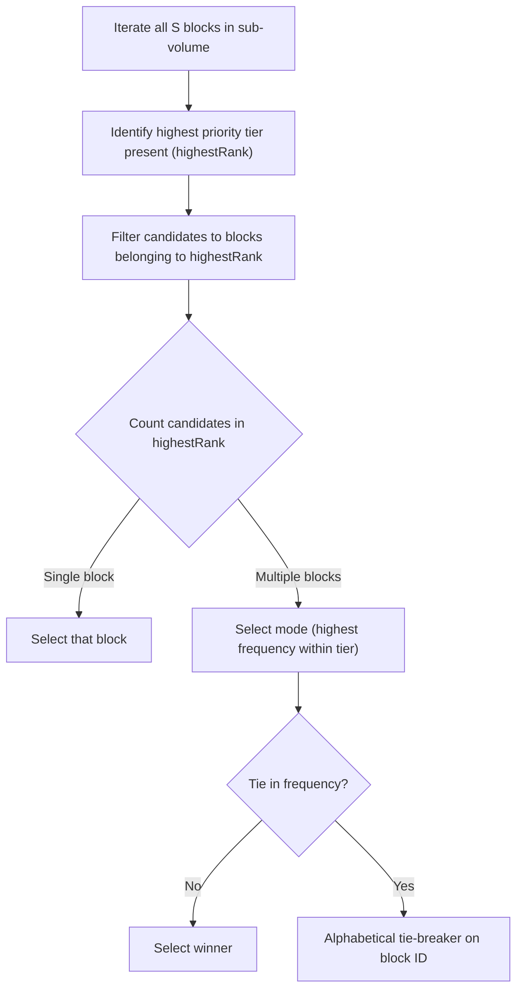

# Block Priority & Classification System

This document provides a comprehensive guide to the **Block Priority Classification System** implemented in **Phase 3 (Task 7)** for intelligent LOD downsampling.

---

## 1. Motivation: Why Naive Majority Vote Fails in RL

In standard voxel or image downsampling, taking the statistical mode (majority vote) or average is common practice. However, in 3D Minecraft reinforcement learning, naive frequency downsampling introduces catastrophic blind spots:

- **Hazard Invisibility**: In an LOD 2 cell ($4\times 4\times 4 = 64$ blocks), a 1-block surface lava puddle surrounded by 63 stone blocks represents only $\approx 1.5\%$ of the volume. Majority vote selects `minecraft:stone`. The agent perceives solid ground, steps into lava, and dies without ever having observed the hazard.
- **Vanishing Critical Resources**: A cluster of 2 Diamond Ores in a 64-block volume of deepslate represents $\approx 3.1\%$. Under majority vote, diamonds are erased, depriving the agent of sparse reward signals for ore discovery.
- **Lost Interactive Objects**: A single chest, spawner, or crafting table in an open cavern or dungeon disappears into air or cobblestone.

**Priority Downsampling** solves this by establishing a non-linear categorical hierarchy: **rare, high-consequence blocks supersede common bulk blocks** regardless of their percentage presence.

---

## 2. The 6 Priority Tiers

The system partitions all Minecraft blocks into a strict 6-rank hierarchy:

$$\text{HAZARD (6)} > \text{INTERACTIVE (5)} > \text{LIQUID (4)} > \text{FOLIAGE (3)} > \text{SOLID (2)} > \text{AIR (1)}$$

```
+--------------------------------------------------------------+
| Rank 6: HAZARDS                                              |
| Lava, Fire, Soul Fire, Campfires, Magma, Cactus, TNT, etc.   |
+--------------------------------------------------------------+
                               | supersedes
+--------------------------------------------------------------+
| Rank 5: INTERACTIVE / CRITICAL                               |
| Chests, Ores, Spawners, Portals, Workstations, Redstone      |
+--------------------------------------------------------------+
                               | supersedes
+--------------------------------------------------------------+
| Rank 4: LIQUIDS                                              |
| Water, Bubble Columns                                        |
+--------------------------------------------------------------+
                               | supersedes
+--------------------------------------------------------------+
| Rank 3: FOLIAGE / PERMEABLE                                  |
| Leaves, Grass, Flowers, Crops, Vines, Bamboo, Cobwebs        |
+--------------------------------------------------------------+
                               | supersedes
+--------------------------------------------------------------+
| Rank 2: COMMON SOLID                                         |
| Stone, Deepslate, Dirt, Sand, Gravel, Wood, Bricks, Glass    |
+--------------------------------------------------------------+
                               | supersedes
+--------------------------------------------------------------+
| Rank 1: AIR                                                  |
| Air, Cave Air, Void Air                                      |
+--------------------------------------------------------------+
```

---

## 3. Tier Breakdown & Block Classification

### Rank 6: `HAZARD`
Blocks that inflict environmental damage, explosive risks, or severe threat:
- **Fire & Lava**: `minecraft:lava`, `minecraft:fire`, `minecraft:soul_fire`, `minecraft:campfire`, `minecraft:soul_campfire`, `minecraft:magma_block`.
- **Damaging Terrain & Plants**: `minecraft:cactus`, `minecraft:sweet_berry_bush`, `minecraft:wither_rose`, `minecraft:pointed_dripstone`, `minecraft:powder_snow`.
- **Explosives & Traps**: `minecraft:tnt`, `minecraft:respawn_anchor`.
- **Sensors / Boss Triggers**: `minecraft:sculk_shrieker`, `minecraft:sculk_sensor`, `minecraft:calibrated_sculk_sensor`.

### Rank 5: `INTERACTIVE` (Critical Gameplay Entities & Ores)
Blocks that the agent can interact with, mine for essential progression, or navigate through:
- **Containers & Storage**: `chest`, `trapped_chest`, `ender_chest`, `barrel`, `hopper`, `dispenser`, `dropper`, `shulker_box` (all variants).
- **Workstations & Progression**: `crafting_table`, `furnace`, `blast_furnace`, `smoker`, `anvil`, `chipped_anvil`, `damaged_anvil`, `enchanting_table`, `brewing_stand`, `smithing_table`, `grindstone`, `loom`, `stonecutter`, `cartography_table`, `beacon`, `conduit`.
- **Spawners & Dungeons**: `spawner`, `trial_spawner`, `vault`.
- **Portals**: `nether_portal`, `end_portal`, `end_portal_frame`, `end_gateway`.
- **Redstone & Triggers**: `lever`, `bell`, `target`, `lightning_rod`, `redstone_block`, `redstone_wire`, `repeater`, `comparator`, `redstone_torch`, pressure plates, buttons, doors, trapdoors.
- **All Critical Ores**:
  - Overworld: Coal, Iron, Copper, Gold, Redstone, Lapis, Diamond, Emerald (both regular and Deepslate variants).
  - Nether: Nether Gold Ore, Nether Quartz Ore, Ancient Debris.
  - Raw blocks: Raw Iron Block, Raw Copper Block, Raw Gold Block.

### Rank 4: `LIQUID`
Non-damaging fluid blocks that influence player locomotion and physics:
- `minecraft:water`, `minecraft:bubble_column`.
*(Note: Lava is classified in Rank 6 as a Hazard).*

### Rank 3: `FOLIAGE` (Permeable Flora & Non-Solid Decor)
Blocks that permit player movement or act as passable vegetation/light sources:
- **Foliage & Flora**: All leaves (`oak_leaves`, etc.), short/tall grass, ferns, all flowers, saplings, crops (wheat, carrots, potatoes, beetroots).
- **Vines & Climbing**: Vines, cave vines, weeping vines, twisting vines, bamboo, sugar cane.
- **Marine Flora**: Kelp, seagrass.
- **Passable Non-Solids**: Cobwebs, moss carpets, torches, lanterns, glow lichen, hanging roots, spore blossoms.

### Rank 2: `SOLID` (Common Structural & Terrain Blocks)
Bulk matter forming the landscape:
- Stone, Deepslate, Granite, Diorite, Andesite, Tuff, Calcite.
- Dirt, Coarse Dirt, Mud, Grass Block, Podzol, Mycelium.
- Sand, Red Sand, Gravel, Sandstone.
- Netherrack, Soul Sand, Soul Soil, Basalt, Blackstone, End Stone.
- Wood logs, wood planks, stairs, slabs, fences.
- Bricks, Concrete, Terracotta, Glass, Obsidian, Bedrock.

### Rank 1: `AIR`
Empty volume:
- `minecraft:air`, `minecraft:cave_air`, `minecraft:void_air`.

---

## 4. Downsampling Algorithm

For a downsampled cell spanning a sub-volume of size $S = \text{stride}^3$ ($S = 8$ for LOD 1, $S = 64$ for LOD 2):



### Algorithm Steps:
1. **Traverse Sub-Volume**: As each block is inspected, determine its priority tier:
   $$\text{highestTier} = \max_{b \in \text{subvolume}} \text{priority}(b)$$
2. **Frequency Count**: Count occurrences of each unique `Block` within the cell.
3. **Tier Filtering**: Ignore all blocks with $\text{priority}(b) < \text{highestTier}$.
4. **Mode Selection**: Within `highestTier`, select the block with the highest frequency count.
5. **Deterministic Tie-Breaking**: If two blocks in `highestTier` share the exact same count, pick the one whose identifier comes first alphabetically.

---

## 5. Performance Engineering

In LOD 2, sampling up to $4,096 \times 64 = 262,144$ blocks every capture requires that block classification take virtually zero time.

### Key Optimizations:
1. **Pointer-Equality Classification**:
   - `Block` instances are singletons in Minecraft.
   - `BlockPriorityRegistry` caches classification results in a `ConcurrentHashMap<Block, BlockPriority>`.
   - After the first lookup, every subsequent resolution is an $O(1)$ reference check.
2. **Block-Reference Counting in Sampler**:
   - `BlockSampler` stores `Map<Block, Integer>` rather than `Map<String, Integer>`.
   - Counting object pointers avoids all String hashing and heap allocations inside the 262,144 loop.
   - String formatting (`Registries.BLOCK.getId().toString()`) occurs **only once per output cell** for the winning block.
3. **Mod-Safe Tag Fallbacks**:
   - When a previously unseen or modded block is encountered, the classifier checks vanilla tags (`BlockTags.ORES`, `BlockTags.FIRE`, `BlockTags.LEAVES`, etc.) before caching the result, ensuring compatibility with modded Minecraft.

---

## 6. Real-World Case Studies

| Sub-Volume Contents | Naive Mode Winner | Priority Downsampling Winner | Practical RL Impact |
|---|---|---|---|
| **63 Deepslate, 1 Lava** | `deepslate` | `minecraft:lava` | Agent learns to steer clear of underground lava pockets before digging into them. |
| **62 Stone, 2 Diamond Ore** | `stone` | `minecraft:diamond_ore` | Agent retains visual awareness of rare ore veins across distant LOD 2 sight lines. |
| **58 Air, 5 Cobblestone, 1 Chest** | `air` | `minecraft:chest` | Agent spots dungeon loot chests from 64 blocks away. |
| **60 Air, 4 Water** | `air` | `minecraft:water` | Agent perceives distant water pools for ML bucket-clutching or navigation. |
| **52 Air, 12 Oak Leaves** | `air` | `minecraft:oak_leaves` | Canopy shapes remain visible against the skybox. |
| **45 Stone, 19 Dirt** | `stone` | `minecraft:stone` | Standard terrain majority voting is preserved when all blocks share the same tier. |

---

## 7. Connection to Future Roadmap Phases

The priority classification system serves as the backbone for subsequent phases:
- **Phase 3 (Task 8 - Physical Channels)**: The priority classification directly seeds the `hazard_flag` ($1.0$ if $\text{highestTier} = \text{HAZARD}$) and `passability` channels.
- **Phase 3 (Task 9 - Integer Palette)**: Reserved IDs (ID 0 for `AIR`, ID 1 for `MASKED`) map cleanly across the tier boundaries.
- **Phase 5 (Occlusion Culling)**: Unseen internal stone blocks can be masked without accidentally culling high-priority ores or hazards.

